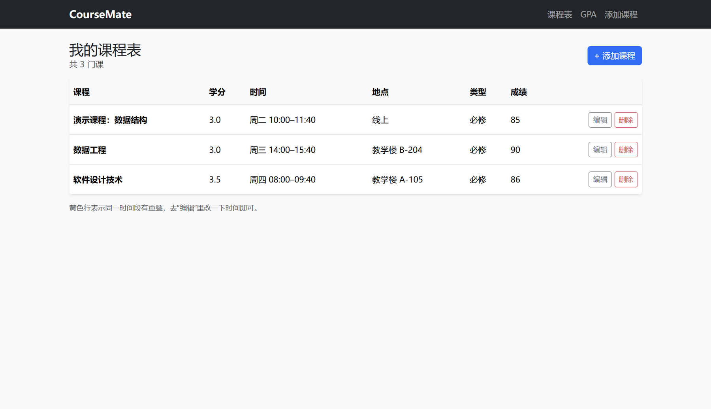
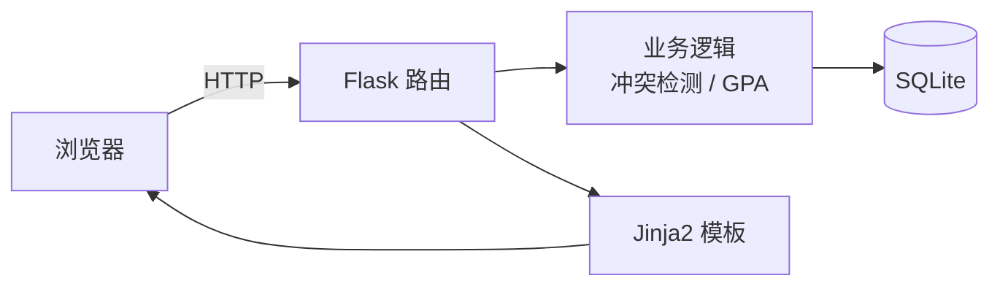

# CourseMate · 课程表与 GPA 助手

一个用 Flask + SQLite 做的课程表管理小工具：添加课程、自动检测时间冲突、计算加权均分和 4.0 绩点，还能算“剩余学分要考多少才能到目标均分”。

这是我大三上的第一个完整项目，目标不是做大，而是走完 **需求 → 开发 → 测试 → 部署 → 演示** 的全流程。

**在线 Demo**：https://course-mate-dyit.onrender.com  
**源码**：https://github.com/Marikiji/course-mate



> Render 免费实例闲置后会休眠，第一次打开可能需要等 30–60 秒。

## 功能

- **课程管理**：添加、编辑、删除课程（名称、学分、星期、时间、地点、类型、成绩）。
- **冲突检测**：同一星期、时间段重叠时，列表里高亮并提示；添加/编辑时直接拦截。
- **GPA 计算**：支持百分制和五级制（A/A-/B+…），按学分加权算均分和 4.0 绩点。
- **What-if**：输入目标均分和剩余学分，算剩余课程需要平均考多少。
- **响应式页面**：Bootstrap 5，手机也能看。

## 技术栈

- Python 3.12 + Flask 3
- SQLite（标准库 `sqlite3`，不需要额外数据库）
- Jinja2 模板 + Bootstrap 5
- pytest（测试）
- Gunicorn（部署）
- Render（免费部署）

## 架构



## 本地运行

Windows PowerShell：

```powershell
cd E:\schedule\course-mate
py -m venv .venv
.\.venv\Scripts\Activate.ps1
pip install -r requirements.txt
python app.py
```

然后打开 http://127.0.0.1:5000 。

如果 `py` 不可用，把 `py` 换成 `python`。如果 PowerShell 不让激活虚拟环境，先执行：

```powershell
Set-ExecutionPolicy -Scope Process -ExecutionPolicy Bypass
```

## 跑测试

```powershell
pytest -q
```

三个测试分别覆盖：添加课程、时间冲突拦截、GPA 计算。

## 部署到 Render

项目自带 `render.yaml`，用 Render 的 Blueprint 一键部署：

1. 代码推到 GitHub 后，打开 [Render](https://render.com) → **New +** → **Blueprint**
2. 选择仓库 `Marikiji/course-mate`，分支 `main`
3. Render 自动读取 `render.yaml`，点 **Deploy Blueprint**
4. 部署完成后得到 `https://course-mate-dyit.onrender.com`

> 注意：Render 免费实例的磁盘是临时的，重新部署后 SQLite 数据会清空。这个项目是演示用途，够用；如果要长期保存，可以换 Render Disk 或 Postgres。

## 目录结构

```
course-mate/
├── app.py               # 路由、冲突检测、GPA 计算
├── templates/
│   ├── base.html        # 布局和导航
│   ├── index.html       # 课程列表
│   ├── form.html        # 添加/编辑表单
│   └── gpa.html         # GPA 与 What-if
├── static/style.css
├── tests/test_app.py
├── requirements.txt
├── Procfile
├── render.yaml
└── README.md
```

## 我做了什么（写进 PS/CV 的版本）

- 独立完成从需求、数据建模、后端路由、前端模板到部署的完整流程。
- 设计 `courses` 表（课程名、学分、星期、起止时间、地点、类型、成绩），用 SQLite 持久化。
- 用“区间重叠”算法做冲突检测：`existing.start < new.end and existing.end > new.start`。
- 实现北交大 4.0 绩点换算和学分加权均分，支持百分制/五级制混合输入。
- 写 pytest 测试覆盖核心逻辑，用 Gunicorn + Render 部署上线。

## 下一步（可选）

- [ ] 周视图（像课程表一样按格子排）
- [ ] 导入学校教务系统 CSV
- [ ] 多学期管理（按学期切换）
- [ ] 用 Chart.js 画均分趋势
- [ ] 换成 Postgres，支持多用户

## License

MIT
